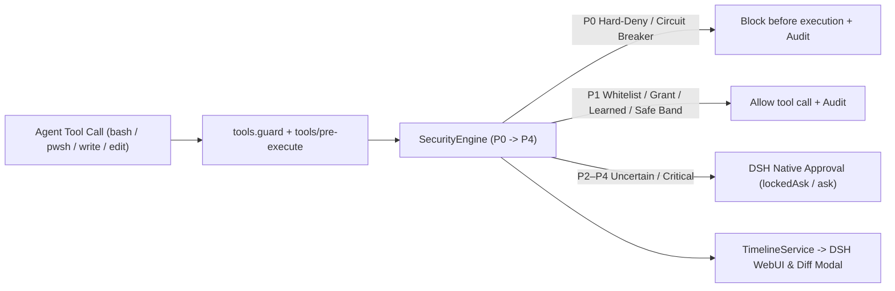

# 📦 @goodandready/dsh-approval-gate

<div align="center">

<h3>Multi-tier command, file, and approval gate + WebUI audit panel for DeepSeek Harness</h3>

<p align="center">
  <a href="https://www.npmjs.com/package/@goodandready/dsh-approval-gate"></a>
  <a href="LICENSE"></a>
  <a href="https://github.com/topics/dsh-plugin"></a>
  <a href="https://nodejs.org"></a>
</p>

<p align="center">
  <a href="https://goodandready.app/"></a>
</p>

<p align="center">
  <a href="README.md"><b>English</b></a> ·
  <a href="README.zh.md"><b>中文说明</b></a> ·
  <a href="README.ru.md"><b>Русский</b></a>
</p>

<table align="center">
  <tr>
    <td align="center">
      ⭐ <strong>If you like this plugin, please star it on GitHub</strong> — it shows me that the plugin is useful to you and motivates me to keep developing it.
      <br><br>
      🐛 <strong>If you find a bug or would like to request a feature</strong>, open a GitHub issue in any language — I will review your proposal and implement useful suggestions in a future plugin version.
    </td>
  </tr>
</table>

</div>

---

## Overview

DeepSeek Harness can still let an agent run a risky tool call when sandbox permissions are broad. `@goodandready/dsh-approval-gate` pairs a **host-side security engine** (`tools.guard` + `tools/pre-execute`) with a **native WebUI panel and settings card**:

- Evaluates POSIX Bash (`bash`, `sh`), Windows PowerShell (`pwsh`, `powershell`), and file-write calls through a 5-stage decision cascade (**P0 Hard-Deny → P1 Whitelist / Grants / Learned → P2 Static & Band Inspection → P3 Optional Classifier → P4 Ask**).
- Isolates writes and snapshots within `workspaceDir`, protects credential files (`.env`, SSH keys, system configs), redacts leaked secrets in telemetry, and supports dry-run / shadow testing.
- Adds an interactive WebUI audit timeline (`conversation.view`), live rule/whitelist & learned-rule manager (`plugins.item`, `plugins.row.config`), and toggleable session header mode badge (`conversation.session.header.utilities`).
- Commands that require human confirmation are routed through DSH’s native approval flow (no custom approval keyword).

## How it works



## WebUI & User Surfaces

- **Session Audit Timeline (`conversation.view`)**: Right-panel **Approvals** tab displaying filterable security events (`All`, `Blocked`, `Asked`, `Allowed`), turn summary status cards, auto-decision countdown badges, unified diff modal previews with collapsible context lines, and live error notifications.
- **Plugin Settings Card (`plugins.item`, `plugins.row.config`)**: Collapsible native card supporting:
  - **`showToolbarBadge`** toggle synced via DSH `configForms`.
  - **Path Whitelist Editor** (`GET/POST /dsh-approval-gate/rules`) — adds/removes safe path prefixes enforced at stage `P1` while preserving stage `P0` hard-denies (e.g., `.env`, `.ssh`, path traversal).
  - **Learned Auto-Approval Rules Manager** (`GET /dsh-approval-gate/learned-rules`, `POST /dsh-approval-gate/learned-rules/revoke`) — revokes session auto-approvals immediately.
- **Header Mode Badge (`conversation.session.header.utilities`)**: Compact mode indicator (`Strict` / `Hybrid` / `Auto` / `Manual`), dynamically hidden when `showToolbarBadge` is disabled.
- **Localization**: Ships runtime UI dictionaries in **English (`en`)** and **Simplified Chinese (`zh`)** using only `--dsw-alias-*` CSS theme tokens for automatic Light/Dark mode support.

## Architecture and modules

| Module group | Key files | Responsibility |
|---|---|---|
| Host entry & live config | `lib/index.js`, `lib/dispatcher.js`, `lib/best-effort.js` | Registers `tools.guard`, `tools/pre-execute`, config schema, volatile live sync, and logged best-effort boundaries |
| Decision cascade & enrichers | `lib/engine.js`, `lib/bands.js`, `lib/decision-enrich.js`, `lib/whitelist.js`, `lib/session-modes.js` | 5-tier P0–P4 evaluation, fast safe/deny bands, live whitelist & custom rule sync, decision risk enrichment |
| Shell & file inspectors | `lib/inspect.js`, `lib/tokenizer.js`, `lib/parsers/pwsh.js`, `lib/inspect-env.js`, `lib/paths.js` | Bounded Bash tokenizer & PowerShell `pwsh` analyzer, recursive `find`/`xargs` checks, env/secret protection, `workspaceDir` confinement |
| Declarative rules & hot reload | `lib/rules-loader.js`, `lib/yaml-parser.js`, `lib/when-matcher.js`, `lib/hotwords.js`, `lib/rules-hmr.js`, `lib/agents-parser.js` | Cascading YAML rules (`workspace` → `user` → `builtin` → `custom`), `AGENTS.md` directives, live HMR watcher |
| Guards, learning & recovery | `lib/breaker.js`, `lib/grants.js`, `lib/learning.js`, `lib/retry-exhaustion.js`, `lib/contract-guard.js`, `lib/overengineering.js`, `lib/version-guard.js`, `lib/snapshots.js` | Circuit breaker, TTL session grants, repeated-confirmation learning, task contracts, file snapshots & rollback |
| Audit, network & WebUI | `lib/audit-log.js`, `lib/redact.js`, `lib/timeline-service.js`, `lib/loopback.js`, `lib/forward-proxy.js`, `lib/network-sandbox.js`, `lib/client.js` | Immutable append-only audit rotation, credential redaction, 8 fail-closed HTTP routes, and DSH WebUI components |

## Security Coverage & Guarantees

| Call / Scenario | Decision | Notes |
|---|---|---|
| `rm -rf`, `sudo rm -r`, `mkfs`, device `dd`, `kill`/`pkill` (including quoted `k''ill`) | Deny | Caught at P0 before execution |
| `find -exec` / `xargs` running destructive commands or writing outside workspace | Deny | Recursive nested-command & predicate inspection |
| PowerShell `Remove-Item -Recurse`, `Stop-Service`, `Clear-Disk`, `Set-ExecutionPolicy Bypass`, `IEX` | Deny | Dedicated `pwsh` parser |
| Writes to `.env`, SSH keys, `credentials.yaml`, `/etc/shadow`, `settings.yaml`, `cordis.patch.yml` | Deny | Protected even inside whitelisted directories unless explicitly permitted for config edits |
| Writes inside configured `whitelistPaths` within `workspaceDir` | Allow (P1) | Skips interactive confirmation while P0 hard-denies remain active |
| `systemctl is-active`, `grep`, `echo`, safe read-only inspections | Allow | Safe band / non-destructive args |
| Uncertain syntax (`$IFS`, unclosed quotes, dynamic redirects) or custom risky calls | Ask (DSH Approval) | Respects `uncertainPolicy` and `unattendedPolicies`; fail-closed by default |

**Boundaries (What it does not replace):** It is a bounded static/behavioral inspector over DSH tool calls, not an OS container or VM. Scheduled jobs (`cron`, `systemd`) or arbitrary external scripts (`bash ./script.sh`) are outside `tools.guard` unless inspected by OS sandboxing.

## Install

```sh
dsh plugin --profile web add @goodandready/dsh-approval-gate@0.1.32
```

Zero external runtime npm dependencies (uses host `@deepseek-ai/cordis` and `@deepseek-ai/schemastery` peer dependencies only).

## Configuration

All options in `cordis.patch.yml` / DSH Settings (`volatile` fields update live without restart):

| Option | Type | Default | Description |
|---|---|---|---|
| `showToolbarBadge` | `boolean` | `true` | Toggle visibility of the toolbar gate-mode pill |
| `toolName` | `string` | `"bash"` | Primary shell tool name |
| `toolNames` | `string[]` | `["pwsh","powershell","bash"]` (win32) / `["bash","sh"]` | Shell tool names inspected by the gate |
| `fileWriteTools` | `string[]` | `write`, `edit`, `Write`, `Edit`, `str_replace`, `apply_patch` | Tool names inspected for file-path safety |
| `workspaceDir` | `string` | `""` (auto-detected) | Workspace root boundary for traversal & snapshot isolation |
| `defaultVerdict` | `"ask" \| "allow"` | `"ask"` | Fallback verdict for unclassified operations |
| `uncertainPolicy` | `"deny" \| "allow"` | `"deny"` | Handling of unparseable shell syntax |
| `allowConfigEdits` | `boolean` | `false` | Permit editing `cordis.patch.yml` / `settings.yaml` (credentials remain blocked) |
| `protectedPaths` | `string[]` | `[]` | Additional protected path patterns |
| `unattended` | `boolean` | `false` | Force unattended handling when approval UI is absent |
| `unattendedPolicies` | `string[]` | `["never"]` | DSH approval policies treated as unattended |
| `dryRun` / `shadowMode` | `boolean` | `false` | Log decisions without blocking execution |
| `auditLogPath` | `string` | `""` | Path to append-only JSONL audit log |
| `auditFailClosed` | `boolean` | `false` | Deny execution if writing to the audit log fails |
| `rulesFile` | `string` | `""` | Custom YAML declarative rules file path (HMR-watched) |
| `maxSnapshotsPerSession` / `maxSnapshotBytes` | `number` | `50` / `1048576` | Pre-execution file rollback snapshot limits |
| `maxFilesPerSession` | `number` | `10` | Threshold for overengineering guard |
| `isolateTempRoots` | `boolean` | `true` | Confine temp-root writes |
| `agentsRules` / `versionGuard` / `requireJustification` | `boolean` | `true` / `true` / `false` | Enable `AGENTS.md` parser, major version bump guard, escalation justification |
| `enableRedundantSandboxRecovery` | `boolean` | `true` | Remediate redundant sandbox escalations |
| `taskContract` | `any` | `undefined` | Optional task scope contract |
| `classifierEndpoint` / `classifierApiKey` / `classifierModel` | `string` | `""` / `""` / `"gpt-4o-mini"` | Optional P3 semantic classifier settings |
| `classifierTimeout` / `classifierTimeoutPolicy` / `classifierMaxContext` / `classifierSlaMs` / `maxPayloadBytes` | `number` / `union` | `3000` / `"strict"` / `1000` / `2000` / `65536` | Classifier timeout, context size, SLA, and payload limits |

## HTTP routes and CLI

All HTTP routes under `/dsh-approval-gate/*` enforce **fail-closed request validation** (`isTrustedRequest`: host connection auth service + loopback `Host`/`Origin`/`Referer` + non-cross-site `Sec-Fetch-Site`), returning `403` to untrusted requests:

| Route | Method | Description |
|---|---|---|
| `/dsh-approval-gate/timeline` | `GET` | Query session security events (`?sessionId=&filter=all\|blocked\|asked\|allowed`) |
| `/dsh-approval-gate/turn-card` | `GET` | Fetch summary card for the latest agent turn |
| `/dsh-approval-gate/diff` | `GET` | Compute collapsible unified diff hunks |
| `/dsh-approval-gate/learned-rules` | `GET` | List session auto-approved rules |
| `/dsh-approval-gate/learned-rules/revoke` | `POST` | Revoke a learned rule by `{ sessionId, key }` |
| `/dsh-approval-gate/mode` | `GET` | Current security mode and `showToolbarBadge` state |
| `/dsh-approval-gate/rules` | `GET` | List active custom rules and whitelisted paths |
| `/dsh-approval-gate/rules` | `POST` | Update `rules` / `whitelistPaths` and sync live to `SecurityEngine` |

**CLI & Verification:**
```sh
npm test            # Run full unit & integration test suite
npm run eval        # Run benchmark security evaluation (dsh-approval-eval)
```

## License

MIT © [GooDAnDReaDY](https://github.com/GooDAnDReaDY)
