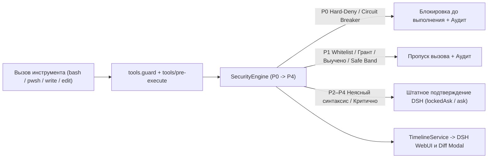

# 📦 @goodandready/dsh-approval-gate

<div align="center">

<h3>Многоуровневый защитный шлюз команд/файлов и панель аудита WebUI для DeepSeek Harness</h3>

<p align="center">
  <a href="https://www.npmjs.com/package/@goodandready/dsh-approval-gate"></a>
  <a href="LICENSE"></a>
  <a href="https://github.com/topics/dsh-plugin"></a>
  <a href="https://nodejs.org"></a>
</p>

<p align="center">
  <a href="https://goodandready.app/"></a>
</p>

<p align="center">
  <a href="README.md"><b>English</b></a> ·
  <a href="README.zh.md"><b>中文说明</b></a> ·
  <a href="README.ru.md"><b>Русский</b></a>
</p>

<table align="center">
  <tr>
    <td align="center">
      ⭐ <strong>Если вам нравится этот плагин, поставьте звезду на GitHub</strong> — это показывает, что он полезен, и мотивирует продолжать разработку.
      <br><br>
      🐛 <strong>Если нашли баг или хотите предложить функцию</strong> — создайте issue на GitHub на любом языке, мы рассмотрим предложение для будущих версий.
    </td>
  </tr>
</table>

</div>

---

## Обзор

Даже в песочнице агент может попытаться выполнить опасную shell-команду или изменить секретный файл при широких правах. `@goodandready/dsh-approval-gate` объединяет **серверный движок безопасности** (`tools.guard` + `tools/pre-execute`) и **нативный интерфейс аудита и настроек в DSH WebUI**:

- Проверяет POSIX Bash (`bash`, `sh`), Windows PowerShell (`pwsh`, `powershell`) и операции записи файлов по 5-ступенчатому каскаду (**P0 Hard-Deny → P1 Whitelist / Гранты / Выученные правила → P2 Статический анализ и полосы → P3 Опциональный классификатор → P4 Запрос подтверждения**).
- Ограничивает запись и откат-снапшоты границами `workspaceDir`, защищает файлы секретов (`.env`, SSH-ключи, системные конфиги), маскирует учётные данные в логах и поддерживает режим `dryRun` / `shadowMode`.
- Добавляет вкладку ленты аудита сессии (`conversation.view`), карточку настроек и правил (`plugins.item`, `plugins.row.config`) и переключаемый индикатор режима в заголовке сессии (`conversation.session.header.utilities`).
- Неопределённые операции маршрутизируются через штатный механизм подтверждения DSH без собственного кодового слова.

## Как это работает



## Интерфейс WebUI

- **Лента аудита сессии (`conversation.view`)**: вкладка **Approvals** с фильтрами (`All`, `Blocked`, `Asked`, `Allowed`), сводной карточкой хода (`TurnCard`), таймером авто-решения (`CountdownBadge`), модальным просмотром diff с сворачиваемым контекстом (`DiffPanelModal`) и баннером ошибок.
- **Карточка настроек плагина (`plugins.item`, `plugins.row.config`)**:
  - Переключатель **`showToolbarBadge`** через `ctx.configForms.get("dsh-approval-gate")`.
  - **Редактор белых списков путей** (`GET/POST /dsh-approval-gate/rules`) — добавление и удаление безопасных директорий на уровне `P1` с сохранением жёсткой защиты `P0` (`.env`, `.ssh`, path traversal).
  - **Менеджер выученных авто-одобрений** (`GET /dsh-approval-gate/learned-rules`, `POST /dsh-approval-gate/learned-rules/revoke`) — мгновенный отзыв запомненных разрешений.
- **Индикатор режима в заголовке сессии (`conversation.session.header.utilities`)**: отображает активный режим (`Strict` / `Hybrid` / `Auto` / `Manual`), скрывается при отключении `showToolbarBadge`.
- **Локализация и темы**: клиент регистрирует словари `en` и `zh` (русский перевод поддерживается пакетом `dsh-russian-lang`) и использует только переменные темы `--dsw-alias-*` для светлой и тёмной темы.

## Архитектура и модули

| Группа модулей | Основные файлы | Ответственность |
|---|---|---|
| Вход и конфигурация | `lib/index.js`, `lib/dispatcher.js`, `lib/best-effort.js` | Регистрация `tools.guard` и `tools/pre-execute`, схема конфигурации, live-синхронизация `volatile`, логирование `bestEffort` |
| Каскад решений | `lib/engine.js`, `lib/bands.js`, `lib/decision-enrich.js`, `lib/whitelist.js`, `lib/session-modes.js` | Каскад `P0`–`P4`, быстрые полосы `Band 0`/`Band 1`, live-применение whitelist и custom rules, обогащение решений |
| Парсеры shell и путей | `lib/inspect.js`, `lib/tokenizer.js`, `lib/parsers/pwsh.js`, `lib/inspect-env.js`, `lib/paths.js` | Токенизация Bash и PowerShell `pwsh`, рекурсивная проверка `find`/`xargs`, защита env/секретов и изоляция `workspaceDir` |
| Декларативные правила и HMR | `lib/rules-loader.js`, `lib/yaml-parser.js`, `lib/when-matcher.js`, `lib/hotwords.js`, `lib/rules-hmr.js`, `lib/agents-parser.js` | Каскадные YAML-правила (`workspace` → `user` → `builtin` → `custom`), правила `AGENTS.md` и горячая перезагрузка |
| Предохранители и откат | `lib/breaker.js`, `lib/grants.js`, `lib/learning.js`, `lib/retry-exhaustion.js`, `lib/contract-guard.js`, `lib/overengineering.js`, `lib/version-guard.js`, `lib/snapshots.js` | Circuit breaker, TTL-гранты, самообучение по подтверждениям, контракты задач, снапшоты до записи |
| Аудит, сеть и WebUI | `lib/audit-log.js`, `lib/redact.js`, `lib/timeline-service.js`, `lib/loopback.js`, `lib/forward-proxy.js`, `lib/network-sandbox.js`, `lib/client.js` | Неизменяемая ротация логов аудита, маскирование секретов, 8 fail-closed HTTP-маршрутов и UI-компоненты |

## Покрытие и ограничения

| Операция / сценарий | Решение | Примечание |
|---|---|---|
| `rm -rf`, `sudo rm -r`, `mkfs`, `dd` на устройства, `kill`/`pkill` (включая `k''ill`) | Блокировка (Deny) | Перехватывается на этапе P0 до запуска |
| `find -exec` / `xargs` с разрушительными командами или записью вне workspace | Блокировка (Deny) | Рекурсивный разбор вложенных команд и предикатов |
| PowerShell `Remove-Item -Recurse`, `Stop-Service`, `Clear-Disk`, `IEX` | Блокировка (Deny) | Отдельный парсер `pwsh` |
| Запись в `.env`, SSH-ключи, `credentials.yaml`, `/etc/shadow`, `settings.yaml`, `cordis.patch.yml` | Блокировка (Deny) | Защищено даже внутри белых списков путей |
| Запись в разрешённый подкаталог `whitelistPaths` внутри `workspaceDir` | Разрешение (P1) | Пропускает запрос подтверждения, не ослабляя P0 |
| `systemctl is-active`, `grep`, `echo`, безопасное чтение | Разрешение | Safe band / безопасные аргументы |
| Нераспознанный синтаксис (`$IFS`, незакрытые кавычки, редиректы) | Запрос подтверждения DSH | Учитывает `uncertainPolicy` и `unattendedPolicies` |

**Границы применимости:** плагин контролирует поддерживаемые вызовы инструментов DSH и не заменяет изоляцию контейнера или ОС; фоновые процессы `cron`/`systemd` и внутренний код уже созданных скриптов `bash ./run.sh` не проходят через `tools.guard`.

## Установка

```sh
dsh plugin --profile web add @goodandready/dsh-approval-gate@0.1.32
```

Нулевые внешние runtime-зависимости (только peer-зависимости хоста `@deepseek-ai/cordis` и `@deepseek-ai/schemastery`).

## Конфигурация

Настройки в `cordis.patch.yml` / интерфейсе DSH (поля `volatile` применяются без перезапуска):

| Параметр | Тип | По умолчанию | Назначение |
|---|---|---|---|
| `showToolbarBadge` | `boolean` | `true` | Показывать индикатор режима в верхней панели |
| `toolName` / `toolNames` | `string` / `string[]` | `"bash"` / по ОС | Имена shell-инструментов для инспекции |
| `fileWriteTools` | `string[]` | `write`, `edit`, `Write`, `Edit`, `str_replace`, `apply_patch` | Инструменты записи файлов, проверяемые по пути |
| `workspaceDir` | `string` | `""` (автоопределение) | Корневая граница рабочего каталога для изоляции записи и снапшотов |
| `defaultVerdict` / `uncertainPolicy` | `"ask"\|"allow"` / `"deny"\|"allow"` | `"ask"` / `"deny"` | Вердикт по умолчанию для неклассифицированных и нераспознанных команд |
| `allowConfigEdits` / `protectedPaths` | `boolean` / `string[]` | `false` / `[]` | Разрешение правки конфигов DSH и пользовательский список защищённых путей |
| `unattended` / `unattendedPolicies` | `boolean` / `string[]` | `false` / `["never"]` | Правила работы в автономном режиме без UI подтверждений |
| `dryRun` / `shadowMode` | `boolean` | `false` | Режим наблюдения и аудита без фактической блокировки |
| `auditLogPath` / `auditFailClosed` | `string` / `boolean` | `""` / `false` | Путь к журналу аудита JSONL и блокировка при сбое записи в аудит |
| `rulesFile` | `string` | `""` | Пользовательский YAML-файл правил с поддержкой HMR |
| `maxSnapshotsPerSession` / `maxSnapshotBytes` | `number` | `50` / `1048576` | Ограничения на откат-снапшоты до выполнения |
| `maxFilesPerSession` / `isolateTempRoots` / `agentsRules` / `versionGuard` / `requireJustification` / `enableRedundantSandboxRecovery` | `number` / `boolean` | `10` / `true` / `true` / `true` / `false` / `true` | Защита от избыточных правок, изоляция temp-путей, правила `AGENTS.md`, контроль major-версий |
| Параметры классификатора P3 (`classifier*`, `maxPayloadBytes`, `taskContract`) | разный | см. `lib/index.js` | Настройки опционального семантического классификатора и контракта задачи |

## HTTP-маршруты и CLI

Все 8 маршрутов под `/dsh-approval-gate/*` используют **fail-closed авторизацию** `isTrustedRequest` (проверка `connection`, loopback `Host`/`Origin`/`Referer`, защита от cross-site `Sec-Fetch-Site`), возвращая `403` недоверенным клиентам:

- `GET /dsh-approval-gate/timeline` — лента событий сессии (`?sessionId=&filter=all|blocked|asked|allowed`)
- `GET /dsh-approval-gate/turn-card` — сводка безопасности последнего хода
- `GET /dsh-approval-gate/diff` — построение унифицированного diff с фолдами
- `GET /dsh-approval-gate/learned-rules` — список выученных авто-одобрений
- `POST /dsh-approval-gate/learned-rules/revoke` — отзыв выученного правила по ключу
- `GET /dsh-approval-gate/mode` — текущий режим гейта и флаг `showToolbarBadge`
- `GET /dsh-approval-gate/rules` — активные пользовательские правила и `whitelistPaths`
- `POST /dsh-approval-gate/rules` — обновление правил и `whitelistPaths` с live-синхронизацией в `SecurityEngine`

**CLI и проверка:**
```sh
npm test            # Полный набор unit- и интеграционных тестов
npm run eval        # Бенчмарк безопасности (dsh-approval-eval)
```

## Лицензия

MIT © [GooDAnDReaDY](https://github.com/GooDAnDReaDY)
