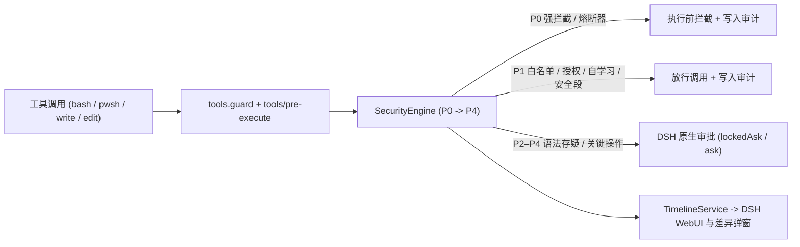

# 📦 @goodandready/dsh-approval-gate

<div align="center">

<h3>DeepSeek Harness 多级命令与文件安全审批门控及 WebUI 审计面板</h3>

<p align="center">
  <a href="https://www.npmjs.com/package/@goodandready/dsh-approval-gate"></a>
  <a href="LICENSE"></a>
  <a href="https://github.com/topics/dsh-plugin"></a>
  <a href="https://nodejs.org"></a>
</p>

<p align="center">
  <a href="https://goodandready.app/"></a>
</p>

<p align="center">
  <a href="README.md"><b>English</b></a> ·
  <a href="README.zh.md"><b>中文说明</b></a> ·
  <a href="README.ru.md"><b>Русский</b></a>
</p>

<table align="center">
  <tr>
    <td align="center">
      ⭐ <strong>如果您喜欢这个插件，请在 GitHub 上点亮 Star</strong> — 这能让我们知道它对您有帮助，并激励持续开发。
      <br><br>
      🐛 <strong>如果您发现 Bug 或有功能建议</strong> — 欢迎用任何语言提交 GitHub Issue，我们会认真评估并在后续版本中跟进实现。
    </td>
  </tr>
</table>

</div>

---

## 概述

当沙箱权限较为宽松时，DeepSeek Harness 仍可能允许代理执行高风险工具调用。`@goodandready/dsh-approval-gate` 将**宿主机侧安全引擎**（`tools.guard` + `tools/pre-execute`）与**原生 WebUI 审计与设置面板**相结合：

- 通过 5 级决策瀑布（**P0 强拦截 → P1 白名单 / 会话授权 / 自学习放行 → P2 静态与分段检测 → P3 可选分类器 → P4 确认拦截**）检查 POSIX Bash（`bash`、`sh`）、Windows PowerShell（`pwsh`、`powershell`）及文件写入调用。
- 将文件写入与回滚快照限制在 `workspaceDir` 内，严格保护凭据文件（`.env`、SSH 密钥、系统配置），对审计日志进行敏感信息脱敏，并支持 `dryRun` / `shadowMode` 演练模式。
- 在 WebUI 中提供会话安全审计时间线（`conversation.view`）、实时规则/白名单与自学习规则管理卡片（`plugins.item`、`plugins.row.config`）及可切换显示的会话头部模式徽章（`conversation.session.header.utilities`）。
- 需要人工确认的操作直接通过 DSH 原生审批流程流转（不自定义单独口令）。

## 工作原理



## WebUI 与交互界面

- **会话审计时间线（`conversation.view`）**：右侧面板**审批记录**标签页，支持按状态筛选事件（全部 / 已拦截 / 待确认 / 已放行），显示本轮安全摘要卡片、自动决策倒计时徽章、支持折叠未变更行数的统一差异预览弹窗以及错误提示条。
- **插件设置卡片（`plugins.item`、`plugins.row.config`）**：可折叠的原生设置卡片，支持：
  - 通过 DSH `configForms` 实时同步切换 **`showToolbarBadge`**。
  - **路径白名单编辑器**（`GET/POST /dsh-approval-gate/rules`）— 实时增删安全路径前缀（在 `P1` 阶段放行，但保留 `P0` 强拦截如 `.env`、`.ssh` 和路径穿越保护）。
  - **自学习免确认规则管理器**（`GET /dsh-approval-gate/learned-rules`、`POST /dsh-approval-gate/learned-rules/revoke`）— 一键即时撤销当前会话的自动放行规则。
- **会话头部模式徽章（`conversation.session.header.utilities`）**：展示当前门控模式（严格 / 混合 / 自动 / 手动），关闭 `showToolbarBadge` 后自动隐藏。
- **多语言与主题适配**：内置 **English（`en`）** 与 **简体中文（`zh`）** 词典，仅使用 `--dsw-alias-*` CSS 变量，原生兼容亮色与暗色主题。

## 架构与模块

| 模块分组 | 主要文件 | 职责 |
|---|---|---|
| 宿主入口与配置同步 | `lib/index.js`, `lib/dispatcher.js`, `lib/best-effort.js` | 注册 `tools.guard`、`tools/pre-execute`、配置 Schema、热更新同步及带日志的容错包装 |
| 决策瀑布与风险标注 | `lib/engine.js`, `lib/bands.js`, `lib/decision-enrich.js`, `lib/whitelist.js`, `lib/session-modes.js` | 5 级 P0–P4 评估、快速安全/拦截分段、白名单与自定义规则实时同步、风险标签与档案富集 |
| Shell 与路径解析 | `lib/inspect.js`, `lib/tokenizer.js`, `lib/parsers/pwsh.js`, `lib/inspect-env.js`, `lib/paths.js` | Bash 分词与 PowerShell `pwsh` 解析、递归 `find`/`xargs` 检查、环境变量防泄漏与工作区隔离 |
| 声明式规则与热重载 | `lib/rules-loader.js`, `lib/yaml-parser.js`, `lib/when-matcher.js`, `lib/hotwords.js`, `lib/rules-hmr.js`, `lib/agents-parser.js` | 层叠 YAML 规则（`workspace` → `user` → `builtin` → `custom`）、`AGENTS.md` 指令解析及文件热重载 |
| 防护、自学习与恢复 | `lib/breaker.js`, `lib/grants.js`, `lib/learning.js`, `lib/retry-exhaustion.js`, `lib/contract-guard.js`, `lib/overengineering.js`, `lib/version-guard.js`, `lib/snapshots.js` | 重试熔断、TTL 临时授权、确认自学习、任务契约检查、执行前文件快照与安全回滚 |
| 审计、网络与 WebUI | `lib/audit-log.js`, `lib/redact.js`, `lib/timeline-service.js`, `lib/loopback.js`, `lib/forward-proxy.js`, `lib/network-sandbox.js`, `lib/client.js` | 不可篡改审计日志轮转、凭据脱敏、8 个 Fail-Closed HTTP 路由及前端 React 组件 |

## 安全覆盖与边界说明

| 调用 / 场景 | 决策 | 说明 |
|---|---|---|
| `rm -rf`、`sudo rm -r`、`mkfs`、设备写入 `dd`、`kill`/`pkill`（含拆分引号） | 拦截 | P0 阶段直接阻断 |
| `find -exec` / `xargs` 执行破坏性命令或向工作区外写文件 | 拦截 | 递归解析内嵌命令与输出谓词 |
| PowerShell `Remove-Item -Recurse`、`Stop-Service`、`Clear-Disk`、`IEX` 等 | 拦截 | 由独立 `pwsh` 解析器检查 |
| 写入 `.env`、SSH 密钥、`credentials.yaml`、`/etc/shadow`、`settings.yaml`、`cordis.patch.yml` | 拦截 | 即使位于白名单目录下仍受 P0 保护 |
| 写入工作区下已配置的 `whitelistPaths` 路径 | 放行（P1） | 跳过交互确认且保留 P0 拦截底线 |
| `systemctl is-active`、`grep`、`echo` 及只读检查 | 放行 | 安全分段放行 |
| 复杂未解析语法或受控风险操作 | 请求 DSH 确认 | 遵循 `uncertainPolicy` 与 `unattendedPolicies`，默认 fail-closed |

**安全边界**：本插件是面向 DSH 工具调用的有界检查器，不替代操作系统容器或 VM 隔离；`cron`、`systemd` 及脱离工具层的脚本文件内部逻辑不经过 `tools.guard`。

## 安装

```sh
dsh plugin --profile web add @goodandready/dsh-approval-gate@0.1.32
```

零外部运行时依赖（仅依赖宿主提供的 `@deepseek-ai/cordis` 与 `@deepseek-ai/schemastery`）。

## 配置项

所有配置均可直接在 `cordis.patch.yml` 或 DSH 设置中调整（`volatile` 字段支持热生效）：

| 字段 | 类型 | 默认值 | 说明 |
|---|---|---|---|
| `showToolbarBadge` | `boolean` | `true` | 是否在工具栏显示当前门控模式徽章 |
| `toolName` / `toolNames` | `string` / `string[]` | `"bash"` / 平台默认 | 需要检查命令参数的 Shell 工具列表 |
| `fileWriteTools` | `string[]` | `write`, `edit`, `Write`, `Edit`, `str_replace`, `apply_patch` | 按路径检查的文件写入工具 |
| `workspaceDir` | `string` | `""`（自动探测） | 路径穿越校验与快照边界目录 |
| `defaultVerdict` / `uncertainPolicy` | `"ask"\|"allow"` / `"deny"\|"allow"` | `"ask"` / `"deny"` | 未分类及未解析语法的默认决策策略 |
| `allowConfigEdits` / `protectedPaths` | `boolean` / `string[]` | `false` / `[]` | 允许编辑 DSH 配置文件或追加自定义受保护路径 |
| `unattended` / `unattendedPolicies` | `boolean` / `string[]` | `false` / `["never"]` | 无人值守审批策略判定 |
| `dryRun` / `shadowMode` | `boolean` | `false` | 仅记录拦截审计而不实际阻断 |
| `auditLogPath` / `auditFailClosed` | `string` / `boolean` | `""` / `false` | 审计日志路径及写入失败时是否阻断执行 |
| `rulesFile` | `string` | `""` | 自定义 YAML 规则文件路径（支持 HMR 热重载） |
| `maxSnapshotsPerSession` / `maxSnapshotBytes` | `number` | `50` / `1048576` | 单会话文件快照保留数量与大小上限 |
| `maxFilesPerSession` / `isolateTempRoots` / `agentsRules` / `versionGuard` / `requireJustification` / `enableRedundantSandboxRecovery` | 数值 / 布尔 | `10` / `true` / `true` / `true` / `false` / `true` | 过度变更保护、临时目录隔离、`AGENTS.md` 规则与版本升级保护 |
| `classifierEndpoint` 等 P3 选项 | 字符 / 数值 | 见 `lib/index.js` | 可选语义分类器地址、密钥、模型及超时策略 |

## HTTP 路由与 CLI

`/dsh-approval-gate/*` 下全部 8 个路由均强制通过 `isTrustedRequest` 做 **Fail-Closed 同源/回环鉴权**（非信任请求返回 `403`）：

- `GET /dsh-approval-gate/timeline` — 查询会话审计事件（支持 `filter` 与 `sessionId`）
- `GET /dsh-approval-gate/turn-card` — 获取最近轮次安全摘要卡
- `GET /dsh-approval-gate/diff` — 计算可折叠统一差异 Hunk
- `GET /dsh-approval-gate/learned-rules` — 查询会话内已学习的免确认规则
- `POST /dsh-approval-gate/learned-rules/revoke` — 撤销指定自学习规则
- `GET /dsh-approval-gate/mode` — 查询当前模式及 `showToolbarBadge` 状态
- `GET /dsh-approval-gate/rules` — 查询自定义规则与路径白名单
- `POST /dsh-approval-gate/rules` — 更新规则与 `whitelistPaths` 并实时同步到 `SecurityEngine`

**CLI 与验证：**
```sh
npm test            # 运行全部单元测试与集成测试
npm run eval        # 运行基准安全评测（dsh-approval-eval）
```

## 许可证

MIT © [GooDAnDReaDY](https://github.com/GooDAnDReaDY)
